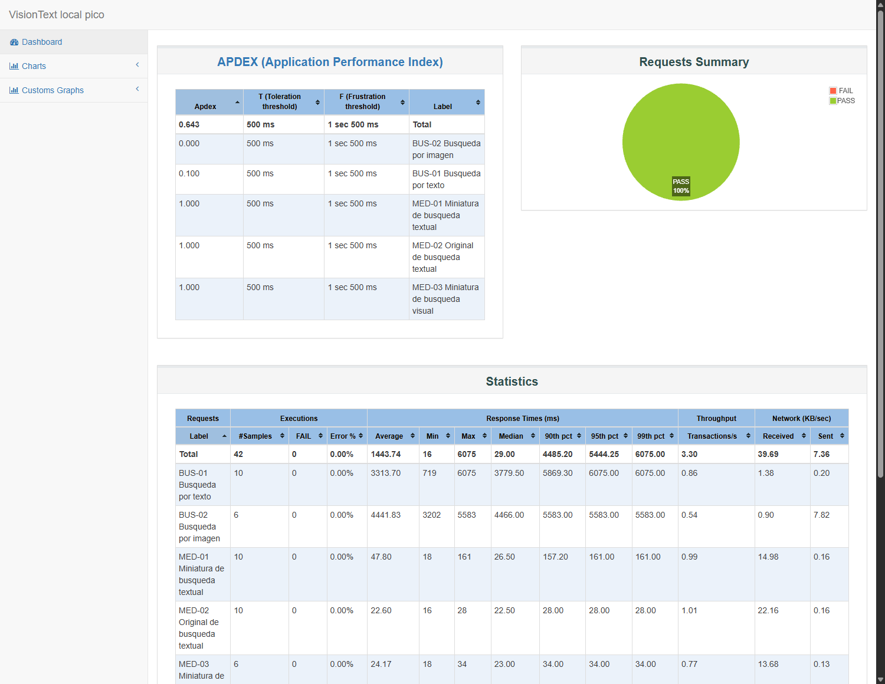
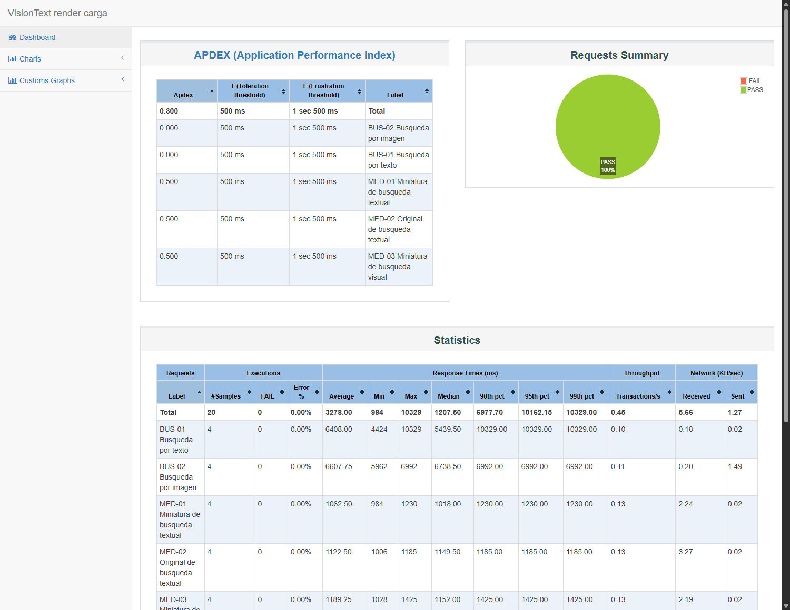

# Resultados de JMeter para VisionText

Cada índice enlaza las muestras JTL y las métricas de su entorno. Las fechas y horas corresponden a Lima. Consulta los [dashboards HTML publicados](#dashboards-html) o [genera los de otros perfiles](../README.md#evidencia-y-lectura) con los JTL guardados.

## Seguimiento local del 20 de noviembre

Se repitieron `pico` con 8 usuarios virtuales y `escritura` con 2. Las dos corridas usaron los mismos planes, 12 imágenes iniciales y los mismos objetivos de latencia en el mismo equipo Windows. Con un hilo de inferencia ambos perfiles quedaron en **REVISAR**. Con cuatro hilos se aprobaron los dos perfiles.

| Operación | p95 con 1 hilo | p95 con 4 hilos | Objetivo p95 |
| --- | ---: | ---: | ---: |
| `pico` · Búsqueda por texto | 12,456 s | 6,075 s | 8,500 s |
| `pico` · Búsqueda por imagen | 11,315 s | 5,583 s | 11,000 s |
| `escritura` · Subida de imagen | 11,714 s | 4,847 s | 10,000 s |

Cada corrida completó 42 muestras en `pico` y 22 en `escritura`, con cero fallos de aserción. Después de las cuatro subidas y borrados, PostgreSQL y FAISS volvieron a 12 registros y vectores. RustFS volvió a 12 originales y 12 miniaturas. [Referencia con un hilo](local/20261120-134658-361883/README.md) · [Corrida aprobada con cuatro hilos](local/20261120-134958-050032/README.md) · [Comando para repetirlas](../README.md#local).

## Corrida completa del 18 de noviembre

| Entorno | Servicio medido | Resultado | Evidencia |
| --- | --- | --- | --- |
| Local | API en loopback, 12 imágenes, PostgreSQL, RustFS, CLIP ONNX y FAISS. Web compilada y servida en el equipo. | 345 muestras válidas, 8 de 10 perfiles dentro de sus objetivos. | [Reportes locales](local/20261118-150033-623716/README.md) |
| Desplegado | API en Render con 1575 imágenes y Google Drive. Web en Vercel. | 69 muestras válidas, 6 de 6 perfiles dentro de sus objetivos. | [Reportes de Render y Vercel](render/20261118-145555-743104/README.md) |

## Comparación con los mismos flujos

| Perfil y métrica | Local | Desplegado |
| --- | ---: | ---: |
| Base con 1 VU, p95 de búsqueda por texto | 1,20 s | 4,63 s |
| Base con 1 VU, p95 de búsqueda por imagen | 2,38 s | 5,87 s |
| Carga con 2 VU, p95 de búsqueda por texto | 3,47 s | 10,33 s |
| Carga con 2 VU, p95 de búsqueda por imagen | 2,43 s | 6,99 s |
| Carga con 2 VU, muestras/s totales | 1,072 | 0,450 |

La carga de dos VU registró **20 peticiones por entorno**, con cuatro búsquedas de cada tipo y sus descargas asociadas. Los catálogos, la red y el almacenamiento difieren. La comparación describe estas ejecuciones y el tamaño reducido de la muestra limita la interpretación de sus percentiles.

El primer acceso a Render tomó **54,74 s** y quedó registrado aparte. El proceso local estuvo listo en **11,96 s**. Su primera petición medida por JMeter, después de verificar salud, tomó **84 ms**. [Métrica del primer acceso a Render](render/20261118-145555-743104/inicio/metricas.json).

## Hallazgos de la corrida local inicial

El perfil `pico` llegó a **8 usuarios virtuales** y tuvo **42 respuestas que cumplieron sus aserciones individuales**. Quedó en **REVISAR** porque el p95 de búsqueda textual fue **11,29 s** frente a un objetivo de **8,5 s**, y el de búsqueda por imagen fue **12,75 s** frente a **11 s**. Las descargas de imágenes se mantuvieron en **23 ms o menos**. [Métricas de pico](local/20261118-150033-623716/pico/metricas.json).

En la rampa de seis usuarios, los p95 de texto e imagen fueron **7,46 s** y **8,14 s**. [Métricas de la rampa](local/20261118-150033-623716/incremental/metricas.json).

El perfil `escritura` completó las cuatro subidas y borrados. El p95 de subida fue **11,20 s** frente al objetivo de **10 s**. Al terminar, PostgreSQL y FAISS volvieron a **12** registros y RustFS a **12** originales y **12** miniaturas. [Métricas de escritura](local/20261118-150033-623716/escritura/metricas.json).

La prueba sostenida registró **132 muestras válidas** con hasta **3 usuarios**, en **74,10 s** entre la primera y la última muestra. [Métricas del perfil sostenido](local/20261118-150033-623716/sostenida/metricas.json).

## Dashboards HTML

Descarga el ZIP, extrae todos los archivos en la misma carpeta y abre `index.html` en el navegador. Cada ZIP contiene el dashboard de JMeter 5.6.3 y sus recursos.

### Pico local con cuatro hilos

La corrida del 20 de noviembre completó 42 muestras sin fallos. [Dashboard HTML (ZIP)](local/20261120-134958-050032/pico/dashboard-html.zip) · [JTL](local/20261120-134958-050032/pico/muestras.jtl).

### Carga en Render

La corrida del 18 de noviembre completó 20 muestras sin fallos. [Dashboard HTML (ZIP)](render/20261118-145555-743104/carga/dashboard-html.zip) · [JTL](render/20261118-145555-743104/carga/muestras.jtl).

[Guía y comandos de JMeter](../README.md).
